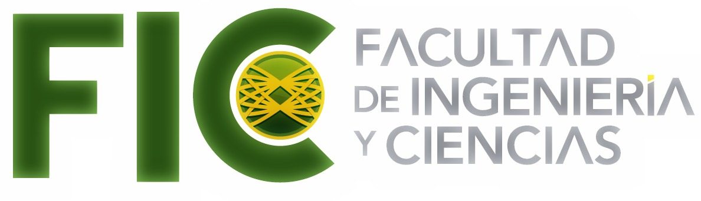
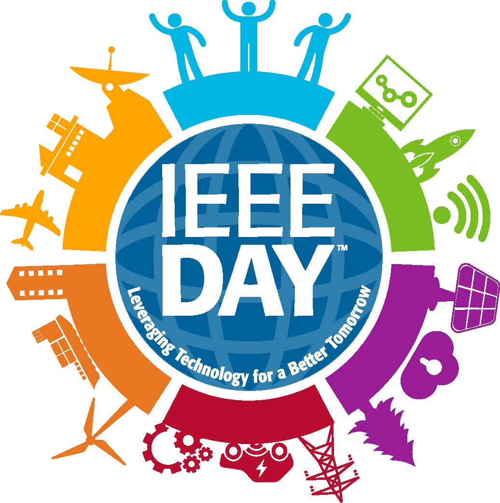

  
  

# Visión artificial: de OpenCV a Deep Learning con YOLO

Bienvenido al curso-taller de visión artificial. En esta guía aprenderás a trabajar con imágenes y video en Python, seleccionar colores y analizar figuras con OpenCV, y comprender el proceso de entrenamiento y uso de un detector de objetos con YOLO.

**Instructor:** M. C. Felix Alejandro Herrera Atilano.

El material sigue los **18 temas del curso**, con un archivo Markdown por tema. Puedes consultarlo antes de clase, seguirlo durante las explicaciones del instructor y utilizarlo para repasar o realizar las actividades en tu equipo.

## Qué necesitas para comenzar

- No necesitas experiencia previa en programación. Si comienzas desde cero, lee primero [Antes de empezar](temas/00-antes-de-empezar.md), donde se explica cómo abrir, ejecutar y leer los ejemplos.
- Una computadora con cámara web y conexión a internet.
- Python y VS Code instalados para las prácticas locales.
- Una cuenta de Google para utilizar Colab durante la preparación y el entrenamiento.
- Acceso a un proyecto de Roboflow cuando trabajes con el dataset.

Si necesitas preparar tu equipo, comienza por los tutoriales de [instalación de Python](Tutorial%20instalaci%C3%B3n%20de%20Python/Tutorial%20instalaci%C3%B3n%20de%20Python.md) e [instalación de VS Code](Tutorial%20de%20instalaci%C3%B3n%20de%20VSCode/Tutorial%20de%20instalaci%C3%B3n%20de%20VSCode.md). Después revisa el tema 03 para comprender qué bibliotecas utiliza el curso y cómo comprobar tu entorno.

## Cómo seguir la guía

1. Si es tu primera experiencia programando, comienza por [Antes de empezar](temas/00-antes-de-empezar.md). Después abre los capítulos desde el índice y avanza en orden. Cada uno explica qué aprenderás y termina con actividades o comprobaciones.
2. Relaciona las explicaciones con la práctica de clase. Consulta las fichas de funciones nuevas: qué hacen, argumentos necesarios, parámetros opcionales y resultado. Identifica qué datos recibe cada operación y qué resultado produce.
3. Para ejecutar un ejemplo, copia su bloque de código en un archivo `.py`, guárdalo con el nombre sugerido y ejecútalo con el intérprete de tu proyecto.
4. Realiza las prácticas de cámara en tu computadora. Colab es un entorno remoto y no accede a la webcam mediante el mismo procedimiento local.
5. Guarda tus observaciones: parámetros, condiciones de iluminación, resultados y situaciones en las que el método falla.
6. Para YOLO, conserva también la versión del dataset, la configuración de entrenamiento y los pesos seleccionados.

Los capítulos **04 y 05** incluyen programas completos para captura de cámara y filtrado de color. El capítulo **07** incluye tres programas separados: erosión, dilatación y erosión seguida de dilatación sobre una máscara verde de un solo intervalo. El capítulo **08** añade un programa completo para encontrar, filtrar y dibujar contornos. El capítulo **09** utiliza esos contornos para buscar candidatos de cuatro esquinas en hojas verdes. Los demás capítulos ofrecen fundamentos, procedimientos y actividades para acompañar las prácticas del taller; no todos contienen un programa completo.

El taller presencial tiene una duración de cuatro horas. La guía amplía las explicaciones para que puedas consultar los detalles después de clase y repetir las actividades a tu ritmo.

## Primera parte: imágenes y OpenCV

Comenzarás con imágenes como arreglos numéricos y después utilizarás una cámara. A partir de sus fotogramas construirás máscaras de color y estudiarás cómo limpiar regiones, obtener contornos y describir figuras.

| Tema | Guía | Qué aprenderás |
| --- | --- | --- |
| 01 | [Introducción a la Visión Artificial y el Procesamiento de Imágenes](temas/01-introduccion-vision-artificial.md) | Definir una tarea y reconocer las etapas de una aplicación. |
| 02 | [¿Qué es una Imagen?](temas/02-que-es-una-imagen.md) | Interpretar píxeles, canales, dimensiones y coordenadas. |
| 03 | [Instalación de Python y bibliotecas a utilizar](temas/03-instalacion-python-bibliotecas.md) | Preparar y comprobar el entorno de trabajo. |
| 04 | [Obtener video de una cámara con Python](temas/04-video-camara-python.md) | Capturar fotogramas, mostrarlos y liberar la cámara. |
| 05 | [Filtros de color](temas/05-filtros-color.md) | Seleccionar verde directamente en BGR y calibrar sus límites con barras. |
| 06 | [Modelos de color](temas/06-modelos-color.md) | Comparar representaciones y rangos; seleccionar y calibrar verde en HSV. |
| 07 | [Operaciones morfológicas](temas/07-operaciones-morfologicas.md) | Practicar erosión, dilatación y erosión seguida de dilatación. |
| 08 | [Contornos](temas/08-contornos.md) | Analizar fronteras, áreas, perímetros y centros. |
| 09 | [Detectar figuras](temas/09-detectar-figuras.md) | Proponer clases geométricas y reconocer los límites de las reglas. |

## Segunda parte: datos, entrenamiento y YOLO

Después estudiarás cómo preparar imágenes etiquetadas, utilizar un dataset y entrenar un detector. El recorrido termina con la descarga de los pesos y su uso local sobre video de cámara.

| Tema | Guía | Qué aprenderás |
| --- | --- | --- |
| 10 | [Introducción a Deep Learning](temas/10-introduccion-deep-learning.md) | Distinguir aprendizaje, entrenamiento e inferencia. |
| 11 | [¿Qué es un dataset?](temas/11-que-es-un-dataset.md) | Organizar datos representativos y separar entrenamiento, validación y prueba. |
| 12 | [Etiquetado y bounding boxes](temas/12-etiquetado-bounding-boxes.md) | Anotar objetos e interpretar cajas y coordenadas normalizadas. |
| 13 | [¿Qué es Roboflow?](temas/13-que-es-roboflow.md) | Relacionar proyectos, anotaciones y versiones. |
| 14 | [Descargar un dataset de Roboflow](temas/14-descargar-dataset-roboflow.md) | Verificar formato, rutas y configuración de los datos. |
| 15 | [Google Colab + GPU + Ultralytics](temas/15-colab-gpu-ultralytics.md) | Preparar el entorno remoto y comprobar la GPU. |
| 16 | [Entrenar modelo YOLO usando GPU](temas/16-entrenar-yolo-gpu.md) | Comprender parámetros, métricas y selección de pesos. |
| 17 | [Descargar YOLO entrenado para uso local](temas/17-descargar-yolo-uso-local.md) | Trasladar el modelo y comprobar su carga en tu equipo. |
| 18 | [Detectar objeto con cámara web usando YOLO](temas/18-detectar-objeto-webcam-yolo.md) | Integrar captura, predicción y visualización. |

## Cómo recorrer la parte de Deep Learning y YOLO

En esta parte seguirás dos entornos: **Colab** para preparar el entrenamiento y **Windows 11 con Python 3.12.10** para utilizar la cámara local. Colab administra su propia versión de Python; no necesitas cambiarla para que coincida con la del laboratorio.

| Etapa | Temas | Resultado que debes poder explicar |
| --- | --- | --- |
| Comprender el aprendizaje | 10 | Diferencia entre entrenar y hacer predicciones. |
| Preparar los ejemplos | 11 y 12 | Qué imágenes, clases y cajas necesita el detector. |
| Organizar y trasladar los datos | 13 y 14 | Proyecto, versión, formato y ubicación del dataset. |
| Preparar el equipo remoto | 15 | Notebook, dependencias y GPU disponible. |
| Ajustar y evaluar el modelo | 16 | Parámetros, métricas, errores y pesos elegidos. |
| Trasladar el resultado | 17 | Archivo de pesos correcto y carga local. |
| Usar la webcam | 18 | Video con detecciones y pruebas de funcionamiento. |

Las actividades utilizan objetos cotidianos como ejemplos de explicación; las clases reales y el dataset deben corresponder a la práctica indicada por el instructor. No necesitas que los objetos sean verdes para YOLO: el filtro verde pertenece a la primera parte del curso.

## Actividad integradora

Durante el taller desarrollarás aplicaciones de Python para detectar colores y formas con OpenCV y utilizar un detector YOLO entrenado sobre video de cámara. Consulta las secciones correspondientes mientras completas cada etapa con el instructor.

Para documentar tus resultados, describe el objetivo, los datos utilizados, los parámetros elegidos y las condiciones de prueba. Incluye aciertos y errores: una detección que funciona con un fondo limpio puede fallar al cambiar la luz, la distancia o el entorno.

Antes de pasar de una etapa a la siguiente, comprueba su resultado por separado: primero captura de cámara, después máscara y contornos; en YOLO, primero datos y entrenamiento, después carga local y finalmente video. Este orden te ayudará a localizar los problemas.
