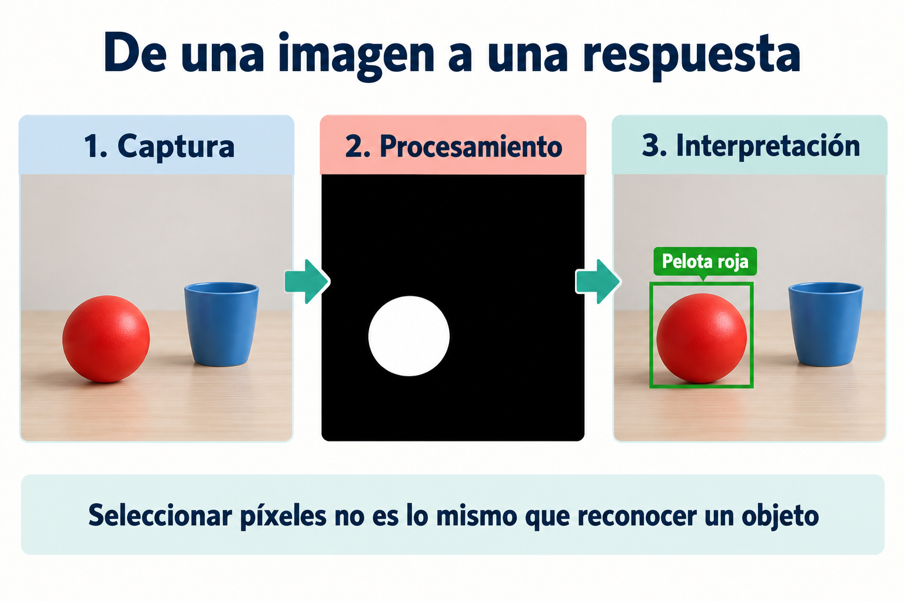
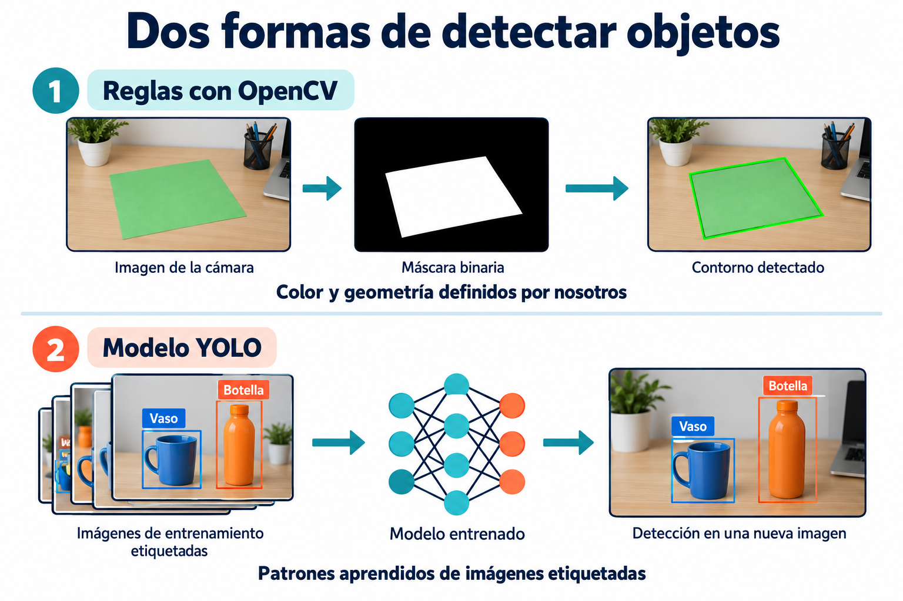

# 01. Introducción a la Visión Artificial y el Procesamiento de Imágenes

## Qué aprenderás

Comprenderás qué significa extraer información de una imagen, cómo se construye una aplicación de visión artificial y por qué el curso comienza con OpenCV antes de entrenar un detector con YOLO. No necesitas saber redes neuronales para empezar; sí conviene distinguir entre una imagen, una característica visual y una decisión.

## La idea en palabras sencillas

Imagina una mesa con una pelota roja. Para una persona, encontrarla parece inmediato. La computadora recibe una fotografía y necesita instrucciones para decidir qué partes corresponden a esa pelota. Esa es la pregunta que guiará el curso: ¿cómo pasamos de una imagen a una respuesta útil?

Primero seleccionaremos colores y formas mediante reglas. Más adelante utilizaremos ejemplos para entrenar un detector. En ambas etapas observaremos el resultado y comprobaremos si coincide con la escena real. No necesitas conocer las matemáticas de una red neuronal para empezar con la cámara.

## 1. Qué es la visión artificial

Una cámara entrega datos numéricos. Una persona ve una taza, reconoce su forma y comprende que puede tomarla. La computadora necesita un procedimiento que relacione esos datos con una interpretación: dónde está un objeto, qué clase de objeto es o cuántos objetos aparecen.

La **visión artificial** estudia esos procedimientos. Por ejemplo, una aplicación puede localizar una pelota roja, verificar que una pieza industrial tenga una forma determinada o identificar un objeto aprendido durante un entrenamiento. En todos los casos conviene definir primero qué respuesta esperamos. «Analizar la cámara» es una tarea demasiado amplia; «localizar la región roja más grande y dibujar su contorno» ya describe un resultado verificable.

## 2. Procesar una imagen y reconocer su contenido

El **procesamiento de imágenes** modifica o transforma la representación de la imagen. Convertir a escala de grises, reducir ruido, cambiar de tamaño o construir una máscara son operaciones de procesamiento. Su salida suele ser otra imagen o un arreglo numérico.

La **interpretación** utiliza esas transformaciones para responder algo sobre la escena. Después de obtener una máscara, por ejemplo, podemos encontrar regiones conectadas, medirlas y decidir si una corresponde a una pelota. El procesamiento prepara información; la interpretación le da un significado relacionado con la tarea.

Esta diferencia evita una confusión frecuente: obtener una imagen con bordes no significa que el programa ya sepa qué objetos hay. Los bordes también aparecen en sombras, texturas y reflejos.

*La máscara selecciona píxeles; identificar la pelota requiere interpretar esa selección según la tarea. Es un esquema ilustrativo, no la salida de un programa ejecutado.*

## 3. El recorrido de una aplicación

1. **Captura:** obtener una imagen desde un archivo, una cámara o un video.
2. **Preparación:** comprobar que la captura fue válida, elegir una resolución y transformar los canales si hace falta.
3. **Extracción de información:** seleccionar colores, encontrar contornos o ejecutar un detector entrenado.
4. **Decisión:** descartar regiones pequeñas, asignar una clase o contar detecciones.
5. **Presentación:** dibujar resultados y permitir que el usuario termine la ejecución.
6. **Evaluación:** comparar lo observado con lo que realmente había en la escena.

Cada etapa puede fallar de una manera diferente. Si la cámara no entrega imágenes, cambiar el modelo no resolverá el problema. Si las cajas aparecen desplazadas, hay que revisar coordenadas y transformaciones antes de entrenar otra vez.

## 4. OpenCV y YOLO en este curso

**OpenCV** ofrece herramientas para manipular imágenes y video. En la primera parte escribirás reglas basadas en color y geometría. Una regla puede seleccionar píxeles dentro de un intervalo HSV y después buscar formas en esa selección. Es fácil inspeccionar cada paso, pero su resultado depende de las condiciones de iluminación y de las reglas elegidas.

**YOLO** es una familia de modelos de detección de objetos. En lugar de indicar manualmente todas las reglas visuales, se entrenan parámetros a partir de imágenes etiquetadas. Un detector aprende patrones asociados con las clases del dataset. Esto puede permitir reconocer objetos con distintos colores y apariencias, aunque exige datos adecuados y una evaluación cuidadosa.

Las herramientas pueden trabajar juntas: OpenCV captura el video y muestra los resultados; YOLO predice clases y cajas sobre cada fotograma. Entrenar y usar el modelo son momentos diferentes del proceso.

*Arriba: reglas de color y geometría. Abajo: aprendizaje con imágenes etiquetadas y uso del modelo sobre una imagen nueva. Las dos herramientas pueden combinarse en una aplicación.*

## 5. Cómo evaluar un primer resultado

Una demostración con un único objeto y un fondo limpio prueba que el procedimiento puede funcionar en esa escena. Para conocer sus límites, cambia una condición a la vez: luz, distancia, orientación, fondo y cantidad de objetos. Registra cuándo deja de funcionar y qué etapa produce el error.

«Tiempo real» también necesita una definición práctica. El video debe responder con suficiente rapidez para la actividad. La velocidad depende de la resolución, del modelo, del equipo y del trabajo adicional realizado por fotograma; no basta con que el programa abra una ventana.

## Actividad de comprensión

Describe una aplicación de detección de una figura de color. Especifica entrada, resultado esperado, condiciones de prueba y dos situaciones difíciles. Después explica qué parte realizarías con OpenCV y qué información necesitarías para sustituir las reglas por YOLO.

## Ideas que debes conservar

La imagen es una fuente de datos; la tarea define qué información queremos extraer. Una aplicación útil necesita tanto un procedimiento como evidencia de que responde correctamente. Las siguientes partes del curso explican los datos y las herramientas que hacen posible ese recorrido.

[Índice del curso](../README.md) · [Siguiente: ¿Qué es una imagen?](02-que-es-una-imagen.md)
