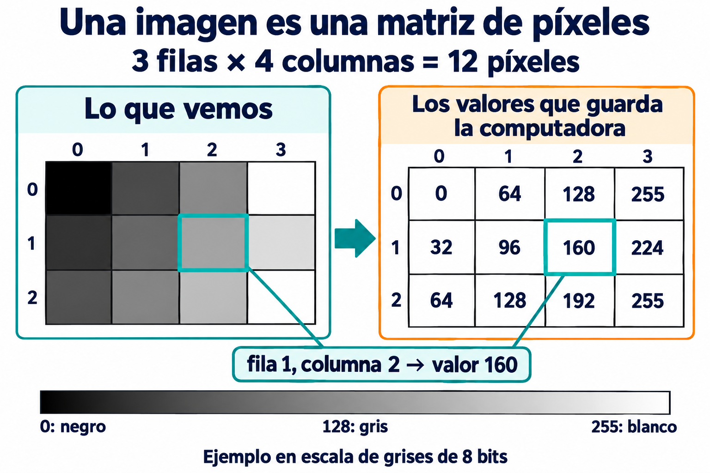

# 02. ¿Qué es una imagen?

## La idea principal

**Una imagen digital es una cuadrícula de píxeles cuyos valores se guardan como números.** Nosotros vemos una fotografía; la computadora trabaja con esos números.

Un **píxel** es una posición de esa cuadrícula. Una **matriz** es una tabla organizada en filas y columnas. Al mostrar la imagen en pantalla, los valores de cada posición determinan el color o la intensidad que vemos.

## 1. De los cuadritos a los números

Imagina una imagen diminuta de **4 píxeles de ancho y 3 de alto**. Tiene 4 columnas y 3 filas: **12 píxeles en total**. En este primer ejemplo usaremos escala de grises, así que cada píxel guarda un solo número.



*La cuadrícula de tonos y la matriz numérica representan la misma imagen: cada casilla ocupa la misma posición en ambas.*

Estos son los valores del ejemplo, escritos por filas:

```text
  0    64   128   255
 32    96   160   224
 64   128   192   255
```

En la representación habitual de **8 bits por canal**:

| Valor | Qué se muestra |
| --- | --- |
| **0** | Negro. |
| **64** | Gris oscuro. |
| **128** | Gris intermedio. |
| **255** | Blanco. |

Entre 0 y 255 hay **256 valores posibles**. Cuanto mayor es el número, más clara se muestra esa posición en esta escala. Un píxel no guarda la palabra «gris»: guarda su valor numérico.

**Cambiar los números cambia la imagen.** Si reemplazas el 160 del ejemplo por 0, ese píxel se verá negro. Las demás posiciones conservarán sus valores. Así empezamos a entender el procesamiento de imágenes: modificar o comparar los datos de sus píxeles.

## 2. ¿Cómo localizamos un píxel?

Para encontrar una casilla necesitas su **fila y su columna**. En los arreglos de Python comenzamos a contar desde **0**.

En la ilustración:

- Las filas son **0, 1 y 2**, de arriba hacia abajo.
- Las columnas son **0, 1, 2 y 3**, de izquierda a derecha.
- La posición **fila 1, columna 2** contiene el valor **160**.

Si ese arreglo se llama `imagen_gris`, podemos consultar esa posición así:

```python
imagen_gris[1, 2]
```

El primer índice es la fila y el segundo es la columna. Es una consulta a una imagen ya creada, no un programa completo.

Al dibujar usamos también coordenadas **(x, y)**: **x corresponde a la columna** y **y a la fila**. El mismo píxel está en **(x = 2, y = 1)**. El origen está en la esquina superior izquierda; x aumenta hacia la derecha e y hacia abajo.

| Forma de señalar el mismo píxel | Orden | Ejemplo |
| --- | --- | --- |
| Acceso al arreglo | Fila, columna | `imagen_gris[1, 2]` |
| Coordenadas para dibujar | x, y | `(2, 1)` |

## 3. Un píxel de color guarda varios valores

En escala de grises usamos un número por píxel. En una imagen de color **RGB** usamos tres: las intensidades de **rojo (R), verde (G) y azul (B)**. Cada componente es un **canal**.


*Los tres valores pertenecen a un solo píxel. No son tres píxeles de la fotografía.*

Por ejemplo, un píxel naranja puede tener:

```text
RGB = [255, 128, 0]
        R    G   B
```

Combina rojo al máximo, verde en un nivel intermedio y azul en cero. Otros ejemplos ideales en RGB son:

| Color | Valores RGB |
| --- | --- |
| Rojo | `[255, 0, 0]` |
| Verde | `[0, 255, 0]` |
| Azul | `[0, 0, 255]` |
| Blanco | `[255, 255, 255]` |
| Negro | `[0, 0, 0]` |

**OpenCV normalmente entrega las imágenes de color en BGR**: azul, verde y rojo. El mismo naranja se guarda como **`[0, 128, 255]`**. El color es el mismo si interpretamos los canales en el orden correcto.

Podemos imaginar una imagen de color como **tres matrices alineadas**: una por canal. En cada fila y columna tomamos los tres valores para formar un píxel. En NumPy se organiza habitualmente como un arreglo de **alto × ancho × canales**.

## 4. Ancho, alto y cantidad de datos

Una cámara que entrega imágenes de **640 × 480** produce:

| Concepto | Valor |
| --- | --- |
| Ancho: columnas | 640 |
| Alto: filas | 480 |
| Cantidad de píxeles | 640 × 480 = **307 200** |
| Valores si está en grises | **307 200**: uno por píxel. |
| Valores si tiene tres canales | 640 × 480 × 3 = **921 600**. |

En una imagen de color con ese tamaño, la forma del arreglo es **`(480, 640, 3)`**: primero alto, después ancho y finalmente canales. No son 921 600 píxeles: son 307 200 píxeles con tres valores cada uno.

Los índices empiezan en 0, así que el último píxel está en **fila 479, columna 639**.

La representación de ocho bits que usamos habitualmente se llama **`uint8`**: cada valor es un entero de 0 a 255. Otras imágenes pueden usar diferentes tipos y escalas; por eso debemos conocer cómo están representadas antes de operar con sus números.

## 5. ¿Qué hace el programa con estos valores?

Con esta idea podemos entender varias operaciones del curso:

- **Filtrar un color:** comparar los valores de cada píxel con unos límites.
- **Convertir a grises:** calcular una intensidad a partir de los canales de color.
- **Crear una máscara:** marcar con 255 los píxeles seleccionados y con 0 los demás.
- **Cambiar el tamaño:** calcular una cuadrícula con otras dimensiones.

Una máscara también es una matriz, pero sus valores expresan **selección**. Un 255 significa «este píxel cumple la regla», no «el modelo está completamente seguro». A diferencia de ella, una imagen gris puede tener muchos niveles intermedios.

Tener más píxeles no garantiza nitidez. Ampliar una fotografía calcula nuevos valores, pero no recupera automáticamente detalles que la cámara no capturó.

## 6. ¿Y un video?

Un video es una **secuencia de imágenes**, llamadas **fotogramas**. Cada fotograma tiene su propia matriz de valores. Al procesar la cámara, repetiremos las operaciones sobre una imagen nueva en cada vuelta del programa.

## Comprueba que lo entendiste

1. En la matriz de la primera ilustración, ¿qué valor está en la fila 0, columna 3? ¿Qué color representa?
2. ¿Por qué un píxel RGB necesita tres números y uno gris solo uno?
3. ¿Cuántos píxeles tiene una imagen de 800 × 600? ¿Cuántos valores tiene si usa tres canales?
4. ¿Qué ocurre si interpretas `[255, 0, 0]` como RGB y después como BGR?

**Idea que debes conservar:** una imagen no es solo algo que vemos; es un arreglo de números que podemos consultar, comparar y transformar. En [Modelos de color](06-modelos-color.md) veremos otras maneras de describir el color de esos mismos píxeles.

[Anterior](01-introduccion-vision-artificial.md) · [Índice](../README.md) · [Siguiente: Instalación](03-instalacion-python-bibliotecas.md)
