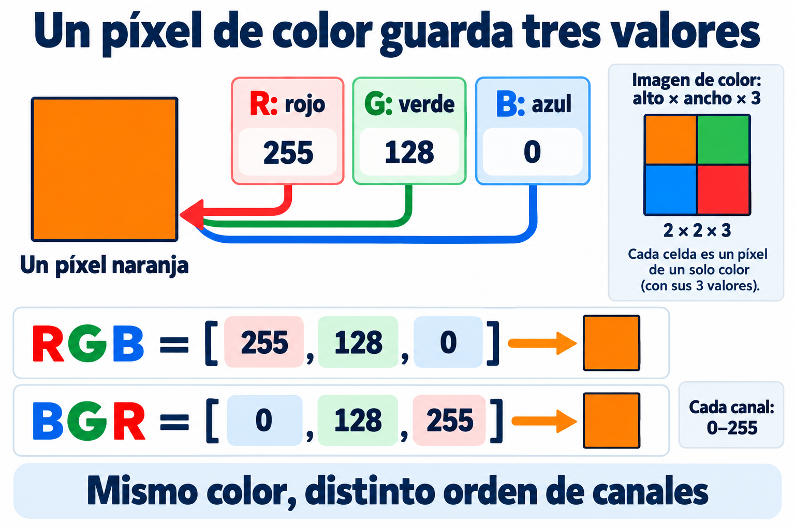
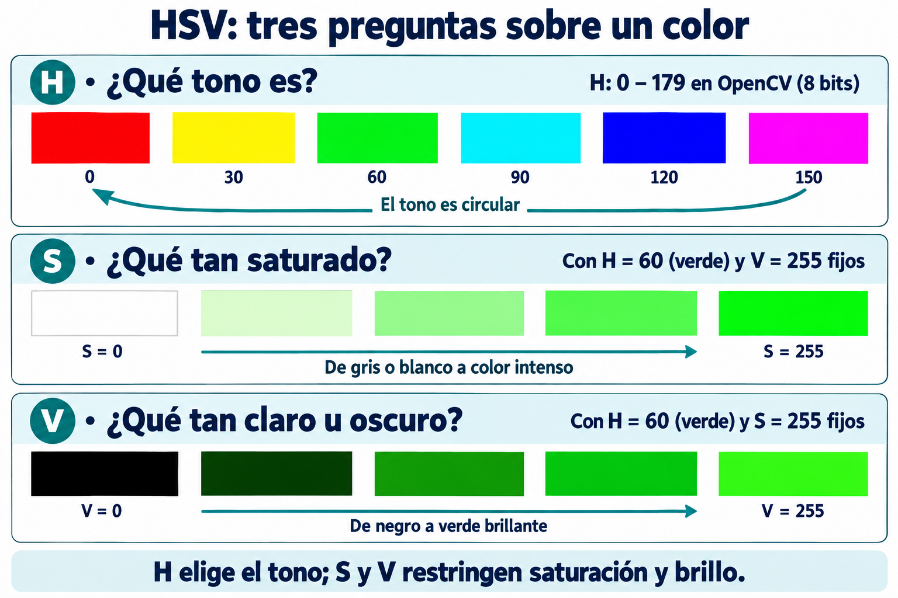
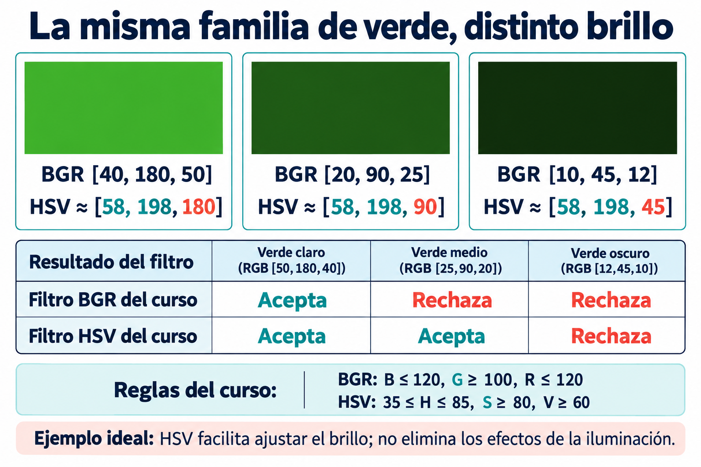

# 06. Modelos de color

## Qué aprenderás

Compararás RGB, BGR, escala de grises y HSV. Convertirás el video a HSV, seleccionarás la hoja verde y ajustarás el filtro con un calibrador propio. Comprenderás por qué separar tono, saturación y brillo facilita la selección de color y cuáles son sus límites.

## La idea en palabras sencillas

Puedes describir una ubicación con una dirección o con coordenadas. Sigue siendo el mismo lugar, pero una descripción puede resultar más útil para una tarea. Con los colores pasa algo semejante: BGR y HSV describen información de color de formas diferentes.

BGR habla de cantidades de azul, verde y rojo. HSV separa tono, saturación y brillo en su representación. Cambiar a HSV no hace que la cámara capture una escena mejor; facilita expresar algunas reglas. Relaciona este capítulo con los filtros que ya ejecutaste, sin intentar memorizar todas las escalas antes de observarlos.

Recuerda el [capítulo sobre imágenes](02-que-es-una-imagen.md): cada píxel de color contiene tres valores. Ahora veremos **qué significa cada uno según la representación que elijamos**. El píxel no cambia de posición; cambiamos cómo describimos su color.

## 1. Una misma imagen, distintas coordenadas de color

Un modelo de color define cómo expresar numéricamente un color. Cambiar de RGB a HSV se parece a describir la misma posición con otro sistema de coordenadas: cambia la representación y facilita ciertas operaciones, pero no elimina automáticamente los problemas de iluminación o ruido.

La conversión debe corresponder al modelo de origen real. Si el fotograma está en BGR y se interpreta como RGB antes de convertirlo, el tono calculado será incorrecto. Por eso siempre conviene registrar de dónde proviene la imagen y qué transformaciones ya recibió.

## 2. RGB y BGR

RGB describe un color combinando intensidades de rojo, verde y azul. Es una representación aditiva: se relaciona con la combinación de luz. Los valores máximos de los tres canales producen blanco en la representación usual de 8 bits; los mínimos producen negro.

BGR contiene los mismos componentes en orden inverso. OpenCV suele trabajar con BGR al leer imágenes de color. No significa que vea colores distintos; significa que el primer canal debe interpretarse como azul. Herramientas de visualización que esperan RGB necesitan la conversión correspondiente.

RGB o BGR son útiles para mostrar imágenes y para muchas operaciones. Sin embargo, si quieres detectar un color, los tres canales pueden cambiar conjuntamente con la iluminación. Un intervalo construido en una escena puede fallar en otra.

### El mismo naranja escrito de dos maneras



| Representación | Valores del mismo píxel naranja | Cómo leerlos |
| --- | --- | --- |
| RGB | `[255, 128, 0]` | Rojo 255, verde 128, azul 0. |
| BGR | `[0, 128, 255]` | Azul 0, verde 128, rojo 255. |

Cambiar de RGB a BGR **reordena los canales**. No convierte un naranja en otro color cuando cada herramienta interpreta el orden correcto. Si entregas los números RGB a una herramienta que espera BGR sin reordenarlos, intercambiarás rojo y azul en la interpretación.

## 3. Escala de grises

La escala de grises resume información de color en una sola intensidad. La conversión convencional utiliza contribuciones distintas de cada canal, relacionadas con la sensibilidad visual; no es simplemente elegir un canal al azar.

Esta representación resulta útil cuando interesan contrastes, bordes o formas y el color no es necesario. También reduce el número de canales que deben procesarse. Su costo es perder información cromática: dos objetos de colores diferentes pueden terminar con intensidades parecidas y ser difíciles de separar.

Es importante distinguir una imagen gris de una máscara binaria. La primera tiene muchos niveles de intensidad; la segunda utiliza dos estados para marcar selección y fondo.

## 4. HSV

HSV representa el color mediante tres componentes:

- **Hue o tono:** indica la familia cromática, como rojo, verde o azul.
- **Saturation o saturación:** expresa cuánta intensidad cromática tiene el color frente a un gris.
- **Value o valor:** corresponde al máximo de los componentes RGB en la definición habitual, y se utiliza como medida de brillo en esta representación.



*En cada fila cambia un solo componente. Esto ayuda a entender qué controla cada barra del calibrador.*

### Leer HSV sin memorizar fórmulas

Piensa en un píxel verde y cambia una sola cosa:

| Si cambias… | Manteniendo… | Qué observas |
| --- | --- | --- |
| **H: tono** | S y V altos | Cambia la familia: rojo, amarillo, verde, cian, azul… |
| **S: saturación** | H verde y V = 255 | Pasa de blanco a verde intenso. |
| **V: valor** | H verde y S = 255 | Pasa de negro a verde brillante. |

Por eso **verde oscuro** y **verde pálido** no son el mismo caso. Un verde oscuro tiene menor V; un verde pálido puede tener V alto y S baja. En ambos puede mantenerse el tono verde.

En general, S = 0 da un gris cuyo nivel depende de V; en la ilustración aparece blanco porque V está en 255. Con V = 0 el resultado es negro, aunque cambies H. Cuando no hay saturación, H deja de describir un tono visible.

En imágenes de 8 bits convertidas con la conversión HSV habitual de OpenCV, el tono se representa de 0 a 179. Es una escala reducida del círculo de aproximadamente 360 grados. Saturación y valor se representan de 0 a 255. Otras conversiones o tipos de dato pueden tener rangos distintos; no hay que mezclar sus límites.

### Por qué H no siempre es una señal fiable

Un píxel casi gris tiene muy poca saturación. En esa situación, hablar de su tono es poco informativo: pequeñas variaciones de canales pueden producir grandes variaciones de H. Lo mismo ocurre en zonas muy oscuras, donde la información de color es débil y el ruido puede dominar.

Por eso un filtro de color suele restringir también S y V. Separar componentes facilita ajustar el filtro, pero HSV no vuelve la detección inmune a sombras, luz coloreada, reflejos o cambios de exposición automática.

### Cómo elegir una representación

| Tarea | Representación habitual | Qué debes revisar |
| --- | --- | --- |
| Mostrar un fotograma con OpenCV | BGR | Orden de canales de origen. |
| Mostrarlo con una herramienta que espera RGB | RGB | Conversión desde BGR si corresponde. |
| Segmentar por tono | HSV | Saturación, brillo y continuidad circular del tono. |
| Obtener bordes o umbralizar por intensidad | Grises | Pérdida de separación entre algunos colores. |
| Encontrar contornos sobre una selección | Máscara binaria | Limpieza y significado del primer plano. |

## 5. Comparar rangos y colores con ejemplos

### Los números tienen significados distintos

| Representación de ocho bits | Orden | Rango de cada componente | Cómo interpretar un límite |
| --- | --- | --- | --- |
| RGB | Rojo, verde, azul | R, G y B: 0–255 | Intensidades de tres componentes. |
| BGR de la cámara | Azul, verde, rojo | B, G y R: 0–255 | Las mismas intensidades que RGB, en otro orden. |
| HSV con `COLOR_BGR2HSV` | Tono, saturación, valor | H: 0–179; S y V: 0–255 | Familia de color, saturación y brillo. |
| Grises | Una intensidad | 0–255 | Nivel de intensidad sin conservar el color. |

Los tres números de HSV **no son cantidades de rojo, verde y azul**. Un H de 60 apunta aproximadamente a verde; no significa 60 % de verde. En la conversión de ocho bits del curso, H equivale aproximadamente a la mitad del ángulo de tono en grados: 60 corresponde a unos 120°. S y V se guardan en 0–255, no como porcentajes. Otras variantes y los arreglos decimales pueden usar escalas diferentes.

### Una misma muestra en RGB, BGR y HSV

Estos valores representan píxeles ideales, no mediciones garantizadas de un objeto físico. Los valores HSV corresponden a la conversión de OpenCV de ocho bits y pueden incluir redondeo.

| Muestra ideal | RGB | BGR | HSV aproximado | Qué permite observar |
| --- | --- | --- | --- | --- |
| Rojo puro | `[255, 0, 0]` | `[0, 0, 255]` | `[0, 255, 255]` | El comienzo de H corresponde a rojo. |
| Amarillo | `[255, 255, 0]` | `[0, 255, 255]` | `[30, 255, 255]` | Un tono distinto del verde. |
| Verde puro | `[0, 255, 0]` | `[0, 255, 0]` | `[60, 255, 255]` | Verde con saturación y valor máximos. |
| Verde oscuro | `[0, 128, 0]` | `[0, 128, 0]` | `[60, 255, 128]` | Conserva H y S; baja V. |
| Verde pálido | `[180, 255, 180]` | `[180, 255, 180]` | `[60, 75, 255]` | Conserva el tono, pero tiene menos saturación. |
| Cian | `[0, 255, 255]` | `[255, 255, 0]` | `[90, 255, 255]` | Mucho verde en BGR no basta para definir «verde». |
| Azul puro | `[0, 0, 255]` | `[255, 0, 0]` | `[120, 255, 255]` | RGB y BGR invierten rojo y azul. |
| Magenta | `[255, 0, 255]` | `[255, 0, 255]` | `[150, 255, 255]` | Otro sector del círculo de tono. |
| Blanco | `[255, 255, 255]` | `[255, 255, 255]` | `[0, 0, 255]` | V alto con S cero: H no identifica un color útil. |
| Gris | `[128, 128, 128]` | `[128, 128, 128]` | `[0, 0, 128]` | Menos brillo, todavía sin saturación. |
| Negro | `[0, 0, 0]` | `[0, 0, 0]` | `[0, 0, 0]` | Sin luz, el tono deja de ser informativo. |

En blanco, gris y negro, OpenCV almacena H como 0 en estos ejemplos. **Eso no los vuelve rojos**: S es cero y el tono no aporta información. Por eso no conviene filtrar solo por H.

El recorrido de H es circular: rojo cerca de 0, amarillo cerca de 30, verde cerca de 60, cian cerca de 90, azul cerca de 120 y magenta cerca de 150, para volver hacia rojo junto a 179. Son referencias de tonos ideales, no intervalos universales para cualquier objeto. El verde permite usar un intervalo continuo; un rojo que cruce la unión puede requerir dos intervalos.

### Qué aceptan los límites de nuestras prácticas

| Modelo | Mínimo | Máximo | Regla que se aplica |
| --- | --- | --- | --- |
| BGR del tema 05 | `[0, 100, 0]` | `[120, 255, 120]` | B ≤ 120, G ≥ 100 y R ≤ 120. |
| HSV de este capítulo | `[35, 80, 60]` | `[85, 255, 255]` | H entre 35 y 85, S ≥ 80 y V ≥ 60. |

En ambos casos deben cumplirse **todos los canales**, incluidos los extremos. Los dos intervalos son elecciones iniciales para el laboratorio; **no son conversiones equivalentes entre sí**. Convertir solamente los dos extremos BGR a HSV no reproduce, en general, todos los colores de un intervalo BGR, porque la transformación cambia la forma de la región seleccionada.

| Píxel BGR de ejemplo | HSV aproximado | Filtro BGR | Filtro HSV | Por qué |
| --- | --- | --- | --- | --- |
| `[40, 180, 50]` | `[58, 198, 180]` | Acepta | Acepta | Cumple los dos conjuntos de condiciones. |
| `[20, 90, 25]` | `[58, 198, 90]` | Rechaza | Acepta | G no llega a 100; el tono sigue siendo verde y V supera 60. |
| `[10, 45, 12]` | `[58, 198, 45]` | Rechaza | Rechaza | En HSV queda por debajo del brillo mínimo. |
| `[180, 255, 180]` | `[60, 75, 255]` | Rechaza | Rechaza | B y R son altos en BGR; S es menor que 80 en HSV. |
| `[255, 255, 0]` | `[90, 255, 255]` | Rechaza | Rechaza | Es cian: H queda fuera del intervalo verde. |



*Observa el segundo verde: G baja de 100 en BGR, pero su tono HSV sigue dentro del intervalo y V todavía supera 60. El tercero también es verde, pero queda por debajo del brillo mínimo del filtro HSV.*

HSV facilita diagnosticar el rechazo. Para el verde oscuro del segundo renglón no necesitamos ampliar H: ya cumple el tono. Para el verde pálido, bajar V mínimo no ayuda: el problema es S. Si bajas S mínimo para recuperarlo, comprueba si también empiezan a entrar superficies poco coloreadas del fondo.

## 6. Por qué HSV facilita seleccionar un color

En RGB y BGR el color se describe con cantidades de rojo, verde y azul; solo cambia el orden de los canales. Por eso, pasar de BGR a RGB no resuelve por sí mismo las dificultades del filtro. Cuando cambia la iluminación de una hoja, pueden cambiar los tres componentes a la vez, aunque nosotros sigamos viendo la misma hoja verde.

Por ejemplo, considera dos píxeles BGR: `[40, 180, 50]` y `[20, 90, 25]`. El segundo tiene la mitad de intensidad en cada componente y representa un verde más oscuro. El filtro BGR de esta práctica acepta el primero, pero rechaza el segundo porque su componente G es menor que 100. Bajar ese mínimo puede recuperar la sombra, pero también admitir otros colores: el filtro comprueba cantidades independientes de azul, verde y rojo, sin exigir una relación entre ellas que describa el tono verde.

HSV facilita expresar una regla más cercana a lo que buscamos: **«seleccionar tonos verdes, suficientemente coloreados y con brillo suficiente»**. Cada parte de esa regla tiene un ajuste específico:

- **H permite elegir la familia de color.** Podemos acotar el verde sin describir de nuevo las cantidades de los tres componentes BGR.
- **S permite excluir zonas poco coloreadas.** Un mínimo de saturación ayuda a rechazar grises, blancos y algunos reflejos que podrían cumplir límites BGR demasiado amplios. También puede eliminar partes de la hoja si se exige demasiado.
- **V permite ajustar el brillo permitido.** Si perdemos zonas verdes oscuras, podemos probar un mínimo V menor manteniendo inicialmente el intervalo de tono. Así resulta más fácil entender qué cambia con cada ajuste.

En el ejemplo anterior, ambos píxeles tienen aproximadamente H = 58 y S = 198 al convertirlos con OpenCV; lo que cambia es V, de 180 a 90. Por eso el intervalo HSV inicial de esta práctica acepta los dos. Es un ejemplo ideal de oscurecimiento proporcional: en una cámara real las sombras, los reflejos y los cambios de luz también pueden modificar el tono y la saturación.

```python
hsv = cv2.cvtColor(frame, cv2.COLOR_BGR2HSV)
mask = cv2.inRange(hsv, lower_green, upper_green)
```

La primera línea cambia la representación de los píxeles; la segunda aplica los límites sobre H, S y V. La selección sigue necesitando que **los tres valores** cumplan sus intervalos. La ventaja está en que ahora resulta más sencillo interpretar y calibrar esos límites. Conservamos `frame` en BGR para mostrar la cámara original.

HSV no agrega información ni garantiza una selección correcta con cualquier iluminación. Si la hoja queda casi negra, pierde saturación o recibe luz de otro color, puede dejar de cumplir el intervalo. El cambio se justifica aquí porque queremos filtrar por color y ajustar sus condiciones de manera comprensible. BGR sigue siendo útil para visualizar el video y puede bastar para filtrar en una escena estable y controlada.

### Comparación de los dos filtros del curso

| Aspecto | BGR directo | HSV |
| --- | --- | --- |
| Entrada al filtro | `frame`, sin conversión. | `hsv`, después de convertir. |
| Significado de los límites | Azul, verde y rojo. | Tono, saturación y brillo. |
| Número de máscaras | Una. | Una. |
| Ajuste de iluminación | Puede necesitar cambios en varios componentes. | Puede ajustarse V conservando inicialmente el intervalo H. |

La ventaja de HSV es facilitar la descripción del color. No hace que el programa sea inmune a sombras, reflejos, luz coloreada o exposición automática. Los dos filtros necesitan calibración. Además, sus intervalos no seleccionan exactamente los mismos colores: una diferencia puede deberse tanto a la representación como a los valores elegidos.

## 7. Práctica: seleccionar verde en HSV

HSV organiza el color mediante H, tono; S, saturación o qué tan alejado está de un gris; y V, valor o brillo. En la conversión de ocho bits usada aquí, H va de 0 a 179 y S y V de 0 a 255.

Guarda el programa como `filtro_verde_hsv.py`. Utiliza la misma hoja y escena. Cierra el programa BGR del tema 05 antes de ejecutarlo. Los límites BGR obtenidos allí no se copian a este filtro: ahora calibraremos valores HSV.

```python
# Importamos las herramientas para la cámara y los arreglos
import cv2
import numpy as np

# Abrimos la cámara principal
cap = cv2.VideoCapture(0)

if not cap.isOpened():
    print("No se pudo abrir la cámara.")
    exit()


# Repetimos la captura y el procesamiento
while True:
    ret, frame = cap.read()

    if not ret:
        print("No se pudo leer el video.")
        break

    # Convertimos el fotograma de BGR a HSV
    hsv = cv2.cvtColor(frame, cv2.COLOR_BGR2HSV)

    # Un único intervalo para el verde: H, S y V
    lower_green = np.array([35, 80, 60], dtype=np.uint8)
    upper_green = np.array([85, 255, 255], dtype=np.uint8)

    # Seleccionamos el verde en una sola máscara
    mask = cv2.inRange(hsv, lower_green, upper_green)


    # Mostramos el video y la selección sin procesar
    cv2.imshow("Camara web", frame)
    cv2.imshow("Mascara original", mask)

    # ESC termina la ejecución
    if cv2.waitKey(1) & 0xFF == 27:
        break

# Dejamos disponible la cámara y cerramos las ventanas
cap.release()
cv2.destroyAllWindows()
```

### Qué cambió respecto al primer programa

```python
hsv = cv2.cvtColor(frame, cv2.COLOR_BGR2HSV)
```

La captura, las ventanas y la salida son iguales. El cambio empieza en `cv2.cvtColor(frame, cv2.COLOR_BGR2HSV)`, que guarda en `hsv` una representación HSV del fotograma. `frame` sigue disponible en BGR para mostrar el video original.

```python
mask = cv2.inRange(hsv, lower_green, upper_green)
```

Ahora `inRange` recibe **`hsv`**, no `frame`. Los límites ya no significan azul, verde y rojo:

| Canal HSV | Mínimo | Máximo | Función del intervalo |
| --- | --- | --- | --- |
| H: tono | 35 | 85 | Seleccionar una zona amplia alrededor del verde. |
| S: saturación | 80 | 255 | Excluir colores demasiado cercanos al gris. |
| V: valor | 60 | 255 | Excluir zonas muy oscuras. |

Un píxel HSV `[60, 180, 150]` cumple las tres condiciones. `[60, 30, 150]` no cumple S y `[60, 180, 40]` no cumple V. Ajustar H no arreglaría esos dos rechazos.

Los valores 35 y 85 no son porcentajes ni grados escritos directamente: pertenecen a la escala de H de OpenCV. No compares una imagen BGR con estos límites HSV; los números tendrían significados distintos.

### Por qué usamos verde y un solo intervalo

```python
mask = cv2.inRange(hsv, lower_green, upper_green)
```

El tono es circular, como los números de una carátula de reloj. En HSV el rojo está cerca de la unión entre el comienzo y el final de la escala, por lo que una selección amplia de rojos puede necesitar dos intervalos. El verde que seleccionamos está en una zona continua, lejos de esa unión. Por eso basta **una llamada a `inRange` y una máscara**.

En esta práctica no hay que unir máscaras ni aprender una operación extra para resolver el color. Nos centraremos en observar la selección. El mismo filtro HSV se reutilizará en las operaciones morfológicas.

## 8. Extra: calibrador HSV

Esta herramienta auxiliar permite ajustar los límites HSV con barras y ver cómo cambia la máscara en tiempo real. Guarda el código como `calibrar_verde_hsv.py` y ejecútalo en el mismo entorno local de las prácticas. Cierra antes cualquier otro programa que use la cámara.

Mueve las barras hasta seleccionar la hoja, pulsa **P** con una ventana de OpenCV seleccionada para imprimir los límites y cópialos al filtro HSV de este capítulo. Pulsa **ESC** para salir. P solo imprime los valores; no modifica el archivo del filtro.

```python
import cv2
import numpy as np


# OpenCV llama a esta función cuando se mueve una barra.
# No necesitamos hacer nada aquí: leeremos las barras en el ciclo.
def al_cambiar(valor):
    pass


cap = cv2.VideoCapture(0)

if not cap.isOpened():
    print("No se pudo abrir la cámara.")
    exit()


# Creamos una ventana antes de agregar sus barras.
cv2.namedWindow("Ajustes HSV", cv2.WINDOW_NORMAL)
cv2.resizeWindow("Ajustes HSV", 700, 180)

# Damos contenido a la ventana que alojará las barras en Windows.
panel = np.zeros((100, 700, 3), dtype=np.uint8)
cv2.putText(panel, "Mueve las seis barras y observa la mascara.", (10, 35), cv2.FONT_HERSHEY_SIMPLEX, 0.6, (255, 255, 255), 1)
cv2.putText(panel, "P: imprimir valores en terminal | ESC: salir", (10, 70), cv2.FONT_HERSHEY_SIMPLEX, 0.6, (255, 255, 255), 1)
cv2.imshow("Ajustes HSV", panel)

# Nombre de la barra, ventana, valor inicial, máximo y función.
# Empezamos con el mismo intervalo HSV verde de este capítulo.
cv2.createTrackbar("H minimo", "Ajustes HSV", 35, 179, al_cambiar)
cv2.createTrackbar("H maximo", "Ajustes HSV", 85, 179, al_cambiar)
cv2.createTrackbar("S minimo", "Ajustes HSV", 80, 255, al_cambiar)
cv2.createTrackbar("S maximo", "Ajustes HSV", 255, 255, al_cambiar)
cv2.createTrackbar("V minimo", "Ajustes HSV", 60, 255, al_cambiar)
cv2.createTrackbar("V maximo", "Ajustes HSV", 255, 255, al_cambiar)


while True:
    ret, frame = cap.read()

    if not ret:
        print("No se pudo leer el video.")
        break

    hsv = cv2.cvtColor(frame, cv2.COLOR_BGR2HSV)

    # Leemos la posición actual de cada barra.
    h_min = cv2.getTrackbarPos("H minimo", "Ajustes HSV")
    h_max = cv2.getTrackbarPos("H maximo", "Ajustes HSV")
    s_min = cv2.getTrackbarPos("S minimo", "Ajustes HSV")
    s_max = cv2.getTrackbarPos("S maximo", "Ajustes HSV")
    v_min = cv2.getTrackbarPos("V minimo", "Ajustes HSV")
    v_max = cv2.getTrackbarPos("V maximo", "Ajustes HSV")

    lower_green = np.array([h_min, s_min, v_min], dtype=np.uint8)
    upper_green = np.array([h_max, s_max, v_max], dtype=np.uint8)

    # Cada mínimo debe ser menor o igual que su máximo.
    rango_valido = h_min <= h_max and s_min <= s_max and v_min <= v_max

    if rango_valido:
        # Seguimos trabajando con un intervalo y una máscara.
        mask = cv2.inRange(hsv, lower_green, upper_green)
    else:
        # Mostramos negro y avisamos si se cruzaron los límites.
        mask = np.zeros(frame.shape[:2], dtype=np.uint8)

    # Copiamos la cámara para escribir los valores sin modificar el HSV.
    preview = frame.copy()

    cv2.putText(preview, f"Min HSV: {lower_green.tolist()}", (10, 30), cv2.FONT_HERSHEY_SIMPLEX, 0.6, (255, 255, 255), 2)
    cv2.putText(preview, f"Max HSV: {upper_green.tolist()}", (10, 60), cv2.FONT_HERSHEY_SIMPLEX, 0.6, (255, 255, 255), 2)

    if rango_valido:
        mensaje = "P: copiar valores en terminal | ESC: salir"
        color = (255, 255, 255)
    else:
        mensaje = "Rango invalido: cada minimo debe ser <= a su maximo"
        color = (0, 0, 255)

    cv2.putText(preview, mensaje, (10, 90), cv2.FONT_HERSHEY_SIMPLEX, 0.5, color, 2)

    cv2.imshow("Camara y valores HSV", preview)
    cv2.imshow("Mascara calibrada", mask)

    key = cv2.waitKey(1) & 0xFF

    # P imprime las dos líneas listas para copiar al programa del filtro.
    if key == ord("p") or key == ord("P"):
        if rango_valido:
            print("\nCopia estas líneas en el filtro:")
            print(f"lower_green = np.array({lower_green.tolist()}, dtype=np.uint8)")
            print(f"upper_green = np.array({upper_green.tolist()}, dtype=np.uint8)")
        else:
            print("Corrige los límites: cada mínimo debe ser <= a su máximo.")

    if key == 27:
        break


cap.release()
cv2.destroyAllWindows()
```

## 9. Consulta: convertir y filtrar en HSV

### `cv2.cvtColor`: cambiar la representación del color

```python
hsv = cv2.cvtColor(frame, cv2.COLOR_BGR2HSV)
```

Forma frecuente en Python: `cv2.cvtColor(src, code, dst=None, dstCn=0)`. El resultado se asigna a una variable, como `hsv`.

| Parámetro | Necesidad | Significado y opciones comunes |
| --- | --- | --- |
| `src` | Obligatorio. | Imagen de entrada, por ejemplo `frame`. |
| `code` | Obligatorio. | Conversión que corresponde al origen: `COLOR_BGR2HSV`, `COLOR_BGR2GRAY` o `COLOR_BGR2RGB`, según la tarea. |
| `dst` | Opcional. | Arreglo de destino compatible. Lo omitimos y utilizamos el resultado devuelto. |
| `dstCn` | Opcional; `0` por defecto. | Número de canales de salida. Con 0 se determina a partir de la conversión. |

**Devuelve:** la imagen convertida. No modifica `frame` cuando guardamos la salida en otra variable sin indicar un destino compartido. Para el filtro elegimos `COLOR_BGR2HSV`; cambiar a `COLOR_RGB2HSV` sería incorrecto si la cámara entregó BGR.

El rango de H de 0 a 179 corresponde a esta conversión de imágenes de ocho bits. Otras variantes, como HSV de rango completo, o imágenes decimales pueden usar escalas distintas. No mezcles sus límites con los del curso.

### Las líneas que conectan la cámara con el filtro

```python
hsv = cv2.cvtColor(frame, cv2.COLOR_BGR2HSV)
lower_green = np.array([35, 80, 60], dtype=np.uint8)
upper_green = np.array([85, 255, 255], dtype=np.uint8)
mask = cv2.inRange(hsv, lower_green, upper_green)
```

`cvtColor` recibe `frame` en BGR y devuelve otra representación que guardamos en `hsv`. `np.array` construye los límites en orden H, S y V. `inRange` recibe ahora la imagen convertida y devuelve una máscara de un canal: 255 si cumple los tres intervalos y 0 si no. No reemplaces `hsv` por `frame` manteniendo estos límites, porque compararías datos con significados diferentes.

## 10. Comparación guiada en el laboratorio

1. Ejecuta el filtro BGR del tema 05 con sus límites iniciales. Observa la hoja y haz una sombra suave; anota qué zonas desaparecen.
2. Sal con ESC y ejecuta el filtro HSV de este capítulo en la misma escena y con los mismos encuadre y luz. Observa la diferencia sin cambiar todavía los límites.
3. Abre el calibrador HSV. Si se pierde una zona oscura que aún conserva color, prueba bajar V mínimo, manteniendo inicialmente H y S. Si aparecen regiones del fondo, anótalo y revierte el ajuste.
4. Observa un reflejo o una zona pálida: puede bajar S. Prueba ese límite por separado; no aumentes el intervalo de H para corregir un problema de saturación.
5. Coloca otro objeto de color cercano al verde. Ajusta H y comprueba qué parte de la hoja y qué parte del otro objeto quedan seleccionadas.
6. Pulsa P y guarda las dos líneas elegidas para el filtro HSV. Estos serán los límites que reutilizarás en morfología, contornos y figuras.

| Observación | Qué registrar en BGR | Qué registrar en HSV |
| --- | --- | --- |
| Sombra suave | Qué componentes tuviste que ajustar. | Si bastó cambiar V y qué fondo apareció. |
| Reflejo o color pálido | Si B o R superaron sus máximos. | Si fue necesario bajar S mínimo. |
| Otro color seleccionado | Qué combinación de límites lo admite. | Si H lo separa sin perder la hoja. |
| Zona casi negra | Si todavía conserva una selección útil. | Si el tono se vuelve inestable o V queda fuera. |

No buscamos que HSV gane en todas las escenas: buscamos justificar los ajustes con el significado de sus canales. Usa límites calibrados y evalúa pérdida de hoja y fondo seleccionado en ambos métodos. La conversión tiene un costo de procesamiento y no añade información a la cámara.

## Comprueba que lo entendiste

- ¿Por qué cambiar el orden RGB por BGR no separa el tono del brillo?
- ¿Qué representa cada número de `[35, 80, 60]` y cuál es su escala?
- ¿Por qué `[20, 90, 25]` puede fallar en BGR y pasar en HSV?
- ¿Por qué blanco y gris pueden tener H = 0 sin ser rojos?
- Si un verde pálido queda fuera por S, ¿ayudaría bajar V mínimo?
- ¿Por qué no debes copiar límites BGR al programa HSV?
- ¿Qué ventaja tiene mantener H mientras calibras el brillo y qué limitaciones tiene esa estrategia?

## Para dar el siguiente paso

Ya podemos seleccionar la hoja en HSV y conservar un intervalo calibrado. En [Operaciones morfológicas](07-operaciones-morfologicas.md) utilizaremos esa máscara para estudiar erosión y dilatación, sin cambiar el modelo de color.

[Anterior](05-filtros-color.md) · [Índice](../README.md) · [Siguiente: Morfología](07-operaciones-morfologicas.md)
