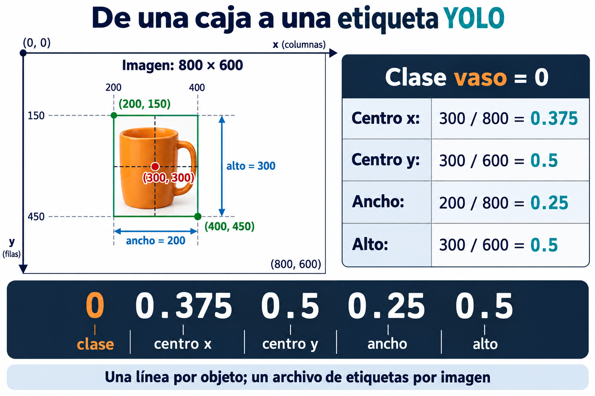

# 12. Etiquetado y bounding boxes

## Qué es el etiquetado y para qué sirve

**Etiquetar** una imagen significa indicar qué objetos aparecen y dónde están. Esa información es la respuesta que utilizamos para enseñar al detector.

Para cada objeto de interés dibujamos una **bounding box**, o caja delimitadora: un rectángulo que rodea el objeto. Después le asignamos su **clase**, por ejemplo «vaso» o «botella».

Si una foto contiene dos vasos y una botella, necesita **tres cajas**, cada una con su clase. Así el modelo aprende tanto a reconocer el tipo de objeto como a localizarlo. Una caja mal colocada o una clase incorrecta le enseña una respuesta equivocada.

## Cómo etiquetar tus imágenes

1. Abre una fotografía en la herramienta de etiquetado.
2. Dibuja una caja ajustada alrededor de cada objeto de las clases del proyecto, sin dejar demasiado fondo.
3. Asigna la clase correcta y repite con los demás objetos de interés.
4. Guarda y revisa que no falten objetos y que las cajas estén bien colocadas.

Usa siempre los mismos nombres y criterios. Si un objeto está parcialmente oculto, acuerda con el instructor cómo anotarlo y mantén ese criterio en todas las imágenes.

## Cómo se guarda una etiqueta en formato YOLO

En el formato YOLO de **detección de objetos**, cada imagen tiene asociado un archivo de texto con el mismo nombre base. Por ejemplo:

| Imagen | Archivo de etiquetas |
| --- | --- |
| `foto_01.jpg` | `foto_01.txt` |
| `foto_02.jpg` | `foto_02.txt` |

Las imágenes y sus etiquetas suelen guardarse en carpetas separadas, conservando esa correspondencia. Cada archivo de etiquetas contiene **una línea por objeto**, con cinco valores separados por espacios:

```text
clase centro_x centro_y ancho alto
```

- **Clase:** número entero que identifica el tipo de objeto. Empieza en 0; por ejemplo, 0 = vaso y 1 = botella. Esta relación debe mantenerse en todo el dataset.
- **Centro x y centro y:** posición del centro de la caja.
- **Ancho y alto:** tamaño de la caja.

Las posiciones y tamaños se guardan **normalizados**, es decir, como proporciones entre 0 y 1. Las medidas horizontales se dividen entre el ancho de la imagen y las verticales entre su alto. El identificador de clase no se normaliza.

## Ejemplo: una imagen y su etiqueta

Imagina que `foto_01.jpg` mide **800 píxeles de ancho y 600 de alto**. Contiene un vaso cuya caja va de x = 200 a x = 400 y de y = 150 a y = 450.

Su centro está en (300, 300), su ancho es 200 y su alto es 300. Para guardarlos en YOLO:

| Medida | Cálculo | Valor normalizado |
| --- | --- | --- |
| Centro x | 300 / 800 | 0.375 |
| Centro y | 300 / 600 | 0.5 |
| Ancho | 200 / 800 | 0.25 |
| Alto | 300 / 600 | 0.5 |

Si «vaso» es la clase 0, el contenido de `foto_01.txt` será:

```text
0 0.375 0.5 0.25 0.5
```

| **Campo** | **Valor** | **Qué describe** |
| --- | --- | --- |
| Clase | 0 | Primer nombre del mapa de clases, por ejemplo vaso. |
| Centro x | 0.375 | Posición horizontal relativa al ancho. |
| Centro y | 0.5 | Posición vertical relativa al alto. |
| Ancho | 0.25 | Caja que ocupa un cuarto del ancho de la imagen. |
| Alto | 0.5 | Caja que ocupa la mitad del alto de la imagen. |

Esta línea es un registro de datos, **no un programa para ejecutar**. Utiliza punto decimal y espacios entre valores. El ejemplo describe esa caja concreta; cada objeto tendrá sus propios valores.

Si una imagen contiene dos objetos, su archivo `.txt` tendrá dos líneas, una por cada caja. No crees un archivo diferente para cada objeto de la misma fotografía.



*La caja se dibuja en píxeles, pero se guarda con centro y tamaño relativos. El identificador de clase sigue siendo un número entero.*

## Qué debes obtener

Las imágenes de tu dataset acompañadas por sus etiquetas: **qué objeto es y dónde está**. Antes de continuar, visualiza algunas cajas sobre sus fotografías y comprueba que las clases y posiciones sean correctas.

La herramienta de etiquetado puede generar los archivos YOLO al exportar; no necesitas calcular y escribir todas las líneas a mano. Entender el formato te ayudará a revisar lo que exportas.

En el siguiente capítulo conoceremos **Roboflow**, donde podremos organizar las imágenes y trabajar con sus anotaciones.

[Anterior](11-que-es-un-dataset.md) · [Índice](../README.md) · [Siguiente: Roboflow](13-que-es-roboflow.md)
